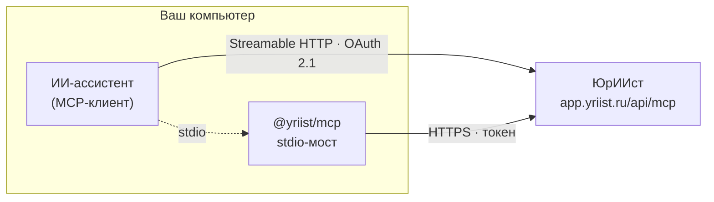

# ЮрИИст MCP

**ИИ-юрист по праву РФ в вашем ИИ-ассистенте.** Один MCP-сервер для Cursor,
VS Code, ChatGPT, Claude, Windsurf, Zed, Codex, Gemini CLI, Copilot CLI и
любого клиента [Model Context Protocol](https://modelcontextprotocol.io).

[](https://github.com/Yriist/yriist-mcp/actions/workflows/ci.yml)
[](docs/protocol.md)
[](package.json)
[](LICENSE)

**Русский** · [English](README.en.md) · [Инструменты](docs/tools.md) · [Протокол](docs/protocol.md) · [Правовая информация](LEGAL.md)

---

## Что получает ассистент

| | |
| --- | --- |
| **Судебная практика** | поиск по актам судов РФ, карточки дел, исходы |
| **Нормы** | текст статьи со сверкой по нескольким источникам, проверка актуальности, сверка ссылок и цифр в готовом тексте |
| **Контрагенты** | карточка компании, реквизиты, проверка рисков |
| **Расчёты** | неустойка, госпошлина, процессуальные сроки по производственному календарю РФ |
| **ИИ-юрист целиком** | `ask_yriist`: полный агент ЮрИИста читает ваши файлы, правит документы, сохраняет ответ чатом в приложении |
| **Ваши данные** | чаты, «Дела», файлы (загрузка и чтение PDF, DOCX, сканов), документы с версиями и выгрузкой в DOCX или PDF, шаблоны (230+), сроки, судебные дела на мониторинге, табличный анализ, память. Только личное пространство: данные команд пока не подключаются |
| **Обезличивание** | ФИО, телефоны, адреса, паспорта, ИНН и счета заменяются метками |
| **Карточки** (MCP Apps) | источники с исходами дел, сроки с кнопкой «Выполнено», ответ с полем для уточнения в клиентах, которые их рисуют |

## Быстрый старт

Нужен аккаунт [ЮрИИста](https://app.yriist.ru).

1. Добавьте в своём приложении удалённый MCP-сервер:

   ```
   https://app.yriist.ru/api/mcp
   ```

2. Приложение откроет окно ЮрИИста. Войдите и разрешите доступ.
3. Спросите: «Найди практику по неустойке за просрочку поставки и посчитай её
   с 01.06 по 10.11 на 500 000 руб.»

Приложение запускает только локальные серверы? Подключитесь через мост из
этого репозитория:

```sh
npx -y @yriist/mcp login
```

Готовый конфиг для своего клиента печатает `npx -y @yriist/mcp config <клиент>`,
список клиентов `npx -y @yriist/mcp config`.

## Как это устроено



Сервер работает удалённо (Streamable HTTP, OAuth 2.1). Пакет `@yriist/mcp`
нужен клиентам, которые не умеют удалённые серверы или OAuth. Это stdio-мост
без зависимостей: он ничего не собирает и хранит у вас на компьютере только
токены входа.

## Подключение

### Клиенты с удалёнными серверами и OAuth

Пакет не нужен: укажите адрес, и клиент сам откроет окно входа.

<details>
<summary><b>Cursor</b></summary>

`~/.cursor/mcp.json`:

```json
{ "mcpServers": { "yriist": { "url": "https://app.yriist.ru/api/mcp" } } }
```

</details>

<details>
<summary><b>VS Code</b></summary>

`.vscode/mcp.json`:

```json
{ "servers": { "yriist": { "type": "http", "url": "https://app.yriist.ru/api/mcp" } } }
```

</details>

<details>
<summary><b>Windsurf / Devin Desktop</b></summary>

Windsurf, `~/.codeium/windsurf/mcp_config.json`:

```json
{ "mcpServers": { "yriist": { "serverUrl": "https://app.yriist.ru/api/mcp" } } }
```

Devin Desktop и Devin CLI, `~/.config/devin/mcp_config.json` (вход:
`devin mcp login yriist`):

```json
{ "mcpServers": { "yriist": { "url": "https://app.yriist.ru/api/mcp", "transport": "http" } } }
```

</details>

<details>
<summary><b>Claude Code</b></summary>

```sh
claude mcp add-json yriist '{"type":"http","url":"https://app.yriist.ru/api/mcp","timeout":300000}' --scope user
```

Затем `/mcp` → yriist → Authenticate. `timeout` (мс) нужен для `ask_yriist`:
без него Claude Code обрывает HTTP-запрос через 60 секунд.
[Плагин](https://github.com/Yriist/yriist-claude-plugin) добавляет команды,
агентов и панель, и `timeout` в нём уже стоит.

</details>

<details>
<summary><b>Claude (приложение для компьютера и claude.ai)</b></summary>

Customize → Connectors → «+ Add» → Add custom connector, адрес
`https://app.yriist.ru/api/mcp`. Claude откроет окно входа ЮрИИста.

</details>

<details>
<summary><b>ChatGPT</b></summary>

Plugins → «+» → Add custom MCP server: MCP Server URL
`https://app.yriist.ru/api/mcp`, авторизация OAuth. Полный MCP с действиями
ChatGPT открывает на тарифах Business, Enterprise и Edu в веб-версии. Меню
ChatGPT меняется часто.

</details>

<details>
<summary><b>Zed</b></summary>

`settings.json` (Zed сам откроет окно входа):

```json
{ "context_servers": { "yriist": { "url": "https://app.yriist.ru/api/mcp" } } }
```

</details>

<details>
<summary><b>Codex CLI</b></summary>

```sh
codex mcp add yriist --url https://app.yriist.ru/api/mcp
codex mcp login yriist
```

Поднимите предел вызова (по умолчанию 60 с) в `~/.codex/config.toml`:

```toml
[mcp_servers.yriist]
url = "https://app.yriist.ru/api/mcp"
tool_timeout_sec = 300
```

</details>

<details>
<summary><b>Gemini CLI</b></summary>

`~/.gemini/settings.json` (вход: `/mcp auth yriist`):

```json
{ "mcpServers": { "yriist": { "httpUrl": "https://app.yriist.ru/api/mcp" } } }
```

</details>

<details>
<summary><b>Другие клиенты</b></summary>

Конфиг с ключами нужного клиента печатает
`npx -y @yriist/mcp config <клиент>`:

| Клиент | `config …` | Файл |
| --- | --- | --- |
| GitHub Copilot CLI | `copilot` | `~/.copilot/mcp-config.json` |
| Antigravity | `antigravity` | `~/.gemini/config/mcp_config.json` |
| Cline | `cline` | MCP Servers → Configure MCP Servers |
| Roo Code | `roo` | `.roo/mcp.json` |
| Continue | `continue` | `.continue/mcpServers/yriist.yaml` (YAML) |
| Kiro | `kiro` | `~/.kiro/settings/mcp.json` |
| JetBrains Junie | `junie` | `~/.junie/mcp/mcp.json` |
| JetBrains AI Assistant | `jetbrains` | Settings → Tools → AI Assistant → MCP |
| LM Studio | `lm-studio` | Program → Install → Edit mcp.json |
| Goose | `goose` | `~/.config/goose/config.yaml` |
| opencode | `opencode` | `opencode.json` |
| Warp | `warp` | Warp Drive → MCP Servers |
| n8n | `n8n` | узел MCP Client Tool |

</details>

### Клиенты со stdio-серверами: через мост

<details open>
<summary><b>Любой клиент со stdio-серверами</b></summary>

```json
{
  "mcpServers": {
    "yriist": { "command": "npx", "args": ["-y", "@yriist/mcp"] }
  }
}
```

На Windows клиент, который запускает сервер без оболочки, не найдёт `npx`
(там это `npx.cmd`). Нужна форма через `cmd`
(`npx -y @yriist/mcp config stdio --windows`):

```json
{
  "mcpServers": {
    "yriist": { "command": "cmd", "args": ["/c", "npx", "-y", "@yriist/mcp"] }
  }
}
```

</details>

Команды моста:

```sh
npx -y @yriist/mcp login     # вход через браузер (--scope research,read: не все права)
npx -y @yriist/mcp status    # кто вошёл, тариф, права, инструменты (--json)
npx -y @yriist/mcp doctor    # проверить сеть, прокси, вход и файлы
npx -y @yriist/mcp config    # готовые конфиги для всех клиентов
npx -y @yriist/mcp logout    # выйти и отозвать доступ
```

> [!TIP]
> Без входа мост сразу отвечает клиенту, открывает окно входа в браузере и
> показывает один инструмент `yriist_login`. После входа клиент получит
> инструменты ЮрИИста сам (`notifications/tools/list_changed`); клиент без
> этой поддержки увидит их после перезапуска сервера. Войти можно и заранее:
> `login`.

### По личному токену

Для скриптов, n8n и клиентов без OAuth. Создайте токен в
[Аккаунт → Подключения](https://app.yriist.ru/account/connections) и
передайте его:

- удалённо в заголовке `Authorization: Bearer yrp_…`;
- через мост: `YRIIST_TOKEN=yrp_… npx -y @yriist/mcp` или файл
  `~/.config/yriist/token` (одна строка, `chmod 600`).

```sh
curl -s https://app.yriist.ru/api/mcp \
  -H "Authorization: Bearer $YRIIST_TOKEN" -H 'Content-Type: application/json' \
  -d '{"jsonrpc":"2.0","id":1,"method":"tools/call","params":{"name":"law_article","arguments":{"articles":[{"act":"ГК РФ","article":"333"}]}}}'
```

## Права и инструменты

При подключении ЮрИИст спрашивает, что разрешить. Инструмент вне выданных
прав клиент не видит. Отозвать доступ можно в «Подключениях».

| Право | Что даёт | Инструменты |
| --- | --- | --- |
| `yriist:research` | практика, нормы, контрагенты, расчёты, поиск, обезличивание | `court_search` `court_case` `law_article` `check_norms` `verify_claims` `company_lookup` `company_check` `requisites_lookup` `calculate_penalty` `calculate_court_fee` `calculate_deadline` `calculate` `web_search` `web_fetch` `anonymize` |
| `yriist:read` | аккаунт и чтение ваших данных | `whoami` `chats_list` `chat_read` `chats_search` `projects_list` `project_read` `files_list` `file_read` `documents_list` `document_read` `document_versions` `document_export` `templates_search` `template_read` `deadlines_list` `cases_list` `case_read` `review_tables_list` `review_table_read` `memory_list` `memory_search` |
| `yriist:write` | создание, изменение и удаление | `project_create` `project_update` `project_delete` `file_upload` `file_upload_begin` `file_upload_finish` `document_create` `document_edit` `document_update` `document_restore` `document_delete` `document_from_template` `deadline_save` `deadline_update` `deadline_delete` `case_track` `case_update` `case_check` `case_delete` `review_table_create` `memory_save` `memory_delete` `chat_delete` (`deadline_complete` устарел, вместо него `deadline_update`) |
| `yriist:agent` | вопрос ИИ-юристу | `ask_yriist` `chat_stop` |

Параметры каждого инструмента описаны в [docs/tools.md](docs/tools.md).
Готовые сценарии (MCP prompts): `legal_research`, `draft_claim`,
`contract_review` (файл, документ или текст и сторона), `deadline_check`,
`counterparty_check`, `court_prep`.

> [!IMPORTANT]
> `ask_yriist` расходует одно сообщение вашего тарифа и отвечает до нескольких
> минут. Поднимите в клиенте предел вызова до 300 секунд: в Claude Code
> `timeout: 300000`, в Codex `tool_timeout_sec = 300`, в Copilot CLI и Junie
> `timeout: 300000`, в Roo и Goose `timeout: 300`. Клиент этого не умеет:
> передайте `wait_seconds: 45`, инструмент вернёт `status: running` и
> `chat_id`, ответ прочитает `chat_read`. Отмена до отправки вопроса ничего
> не списывает. Клиент оборвал вызов позже: сервер допишет ответ, сообщение
> уже потрачено. Не задавайте вопрос заново, найдите чат через `chats_list`,
> а остановить ответ можно `chat_stop`.

> [!NOTE]
> Нужно только исследование, без доступа к вашим чатам и документам? Выдайте
> одно право `yriist:research`. Личный токен с ним создаётся в «Подключениях».

### Файлы

Небольшой файл (до 2,5 МБ) клиент отправляет в `file_upload` целиком, в
base64. Файл побольше и любой файл из клиента с терминалом загружайте в два
шага: `file_upload_begin` вернёт ссылку, клиент отправит на неё файл HTTP PUT,
`file_upload_finish` вернёт `file_id`. Затем `file_read` отдаёт текст (скан
сначала вернёт `status: processing`), а `ask_yriist`, `anonymize` и
`review_table_create` принимают файл по `file_id`.

### Длинные ответы

`chat_read`, `document_read` и `file_read` отдают длинный текст частями
(`from_message`, `from_paragraph`, `from_char`) и объявляют
`_meta["anthropic/maxResultSizeChars"] = 200000`, чтобы Claude Code показал
ответ целиком, а не сохранил его в файл.

## Мост: параметры и поведение

| Переменная / флаг | Что |
| --- | --- |
| `--url`, `YRIIST_MCP_URL` | другой сервер; только `https://`, `http://` лишь для `localhost` |
| `YRIIST_TOKEN` | личный токен вместо OAuth |
| `--no-browser`, `YRIIST_NO_BROWSER=1` | не открывать браузер, ссылка для входа уходит в stderr |
| `--scope` (у `login`) | какие права просить: `research,read,write,agent` (по умолчанию все) |
| `XDG_CONFIG_HOME` | где хранить вход (`$XDG_CONFIG_HOME/yriist/credentials.json`, права 0600) |
| `YRIIST_CREDENTIALS` | путь к файлу входа целиком (вместо `credentials.json` выше) |
| `HTTPS_PROXY`, `HTTP_PROXY`, `NO_PROXY` | корпоративный прокси; нужен Node.js ≥ 22.21 или ≥ 24, мост сам включит `NODE_USE_ENV_PROXY=1` |
| `NODE_EXTRA_CA_CERTS` | сертификат прокси с проверкой TLS (PEM-файл) |

<details>
<summary>Что делает мост</summary>

- Читает JSON-RPC из stdin и пересылает каждое сообщение на сервер с токеном.
  В stdout пишет только ответы, журнал в stderr.
- Понимает JSON- и SSE-ответы (SSE-ответ дочитывает до конца и передаёт
  целиком), переносит `Mcp-Session-Id` и согласованную версию протокола.
- Пакет JSON-RPC (batch) с протоколом 2025-06-18 и новее отправляет
  отдельными запросами и отвечает одним массивом.
- Ошибку сервера без `id` (слишком большой запрос, неверный заголовок)
  возвращает как ответ на тот запрос, к которому она относится.
- При `503`, `502`, `504` и обрыве соединения повторяет запрос с паузой (по
  `Retry-After`), если запрос ничего не меняет: списки, чтение, инструменты
  «только чтение». `ask_yriist` и действия мост не повторяет.
- На `403 insufficient_scope` открывает вход с недостающим правом и
  повторяет запрос; с личным токеном объясняет, какое право добавить.
- Обновляет токен один раз на все ожидающие запросы. Одним файлом входа
  могут пользоваться несколько клиентов сразу, поэтому мост меняет файл под
  блокировкой.
- `notifications/cancelled` обрывает соответствующий запрос к серверу.
- Долгому вызову с `progressToken` шлёт `notifications/progress` каждые
  15 секунд.
- Входит по OAuth 2.1 из спецификации MCP: метаданные ресурса и сервера
  авторизации, динамическая регистрация, код и PKCE S256 на `127.0.0.1`,
  проверка `state` и `iss`. Сетевая ошибка сохранённый вход не стирает.

Подробности в [docs/protocol.md](docs/protocol.md).

</details>

## Если что-то не так

| Симптом | Что сделать |
| --- | --- |
| «Нужен вход в ЮрИИст» | `npx -y @yriist/mcp login`, затем перезапустите сервер в клиенте |
| «Личный токен недействителен» | создайте новый в «Подключениях» или уберите `YRIIST_TOKEN` и файл `token`, чтобы вернуться к OAuth |
| Окно входа: «Приложение не зарегистрировано» | `npx -y @yriist/mcp logout`, затем `login` |
| Клиент не видит инструменты | `npx -y @yriist/mcp status` покажет аккаунт и выданные права |
| Нет `ask_yriist` или действий | вы не выдали право при входе: мост предложит его выдать при первом вызове, или запустите `npx -y @yriist/mcp login` |
| Вход по SSH или без браузера | `login --no-browser` и проброс порта из ссылки (`ssh -L PORT:127.0.0.1:PORT`), либо личный токен |
| `ЮрИИст недоступен: ECONNREFUSED / ETIMEDOUT` за прокси | задайте `HTTPS_PROXY` (Node.js ≥ 22.21 или ≥ 24); `npx -y @yriist/mcp doctor` покажет, что видит мост |
| `self-signed certificate` / `UNABLE_TO_VERIFY_LEAF_SIGNATURE` | прокси подменяет сертификаты: `NODE_EXTRA_CA_CERTS=/путь/к/ca.pem` |
| `ask_yriist` обрывается через 60 секунд | поднимите предел вызова в клиенте (выше) или передайте `wait_seconds: 45` |
| Windows: сервер не запускается (`spawn npx ENOENT`) | форма `"command": "cmd", "args": ["/c", "npx", "-y", "@yriist/mcp"]` |

## Разработка

```sh
npm test                                         # node:test, мок-сервер OAuth + MCP
node bin/yriist-mcp.mjs status --url http://localhost:3000/api/mcp
npm run docs:tools                               # docs/tools.json + docs/tools.md из tools/list сервера
npm run docs:tools -- --offline --check          # то же, что CI: tools.md совпадает со снимком
```

Как прислать изменение: [CONTRIBUTING.md](CONTRIBUTING.md). Об уязвимостях:
[SECURITY.md](SECURITY.md).

## Правовая информация

Это официальный репозиторий ООО «ЮрИИст». Его код распространяется по
лицензии [MIT](LICENSE). Сервис ЮрИИст, к которому он подключает, работает по
[пользовательскому соглашению](https://yriist.ru/offer) и
[политике конфиденциальности](https://yriist.ru/privacy). Результаты работы
ИИ носят информационно-справочный характер и не являются юридической
консультацией. ЮрИИст не передаёт ваши данные третьим лицам: вы сами получаете
их через приложение, которое подключили. Полный текст в [LEGAL.md](LEGAL.md).
