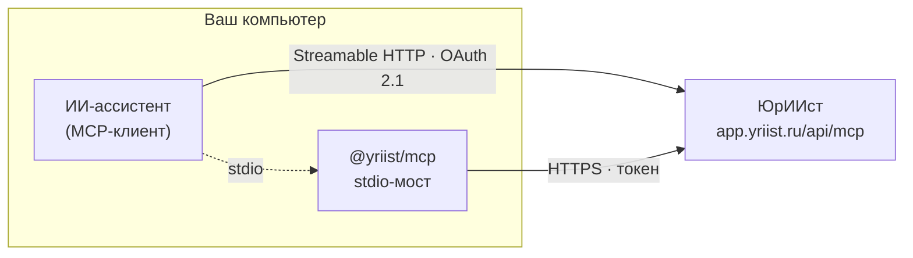

# ЮрИИст MCP

**ИИ-юрист по праву РФ в вашем ИИ-ассистенте.** Один MCP-сервер для Cursor,
VS Code, ChatGPT, Claude, Windsurf, Zed, Gemini CLI и любого клиента
[Model Context Protocol](https://modelcontextprotocol.io).

[](https://github.com/Yriist/yriist-mcp/actions/workflows/ci.yml)
[](docs/protocol.md)
[](package.json)
[](LICENSE)

**Русский** · [English](README.en.md) · [Инструменты](docs/tools.md) · [Протокол](docs/protocol.md) · [Правовая информация](LEGAL.md)

---

## Что получает ассистент

| | |
| --- | --- |
| **Судебная практика** | поиск по актам судов РФ, карточки дел, исходы |
| **Нормы** | текст статьи со сверкой по нескольким источникам, проверка актуальности, сверка ссылок и цифр в готовом тексте |
| **Контрагенты** | карточка компании, реквизиты, проверка рисков |
| **Расчёты** | неустойка, госпошлина, процессуальные сроки по производственному календарю РФ |
| **ИИ-юрист целиком** | `ask_yriist` — полный агент ЮрИИста; ответ сохраняется чатом в приложении |
| **Ваши данные** | чаты, документы, шаблоны (230+), «Сроки и дела», память |
| **Карточки** (MCP Apps) | источники с исходами дел, сроки с кнопкой «Выполнено», ответ с полем для уточнения — в клиентах, которые их рисуют |

## Быстрый старт

Нужен аккаунт [ЮрИИста](https://app.yriist.ru).

1. Добавьте в своём приложении удалённый MCP-сервер:

   ```
   https://app.yriist.ru/api/mcp
   ```

2. Приложение откроет окно ЮрИИста — войдите и разрешите доступ.
3. Спросите: «Найди практику по неустойке за просрочку поставки и посчитай её
   с 01.06 по 10.11 на 500 000 руб.»

Приложение запускает только локальные серверы? Тогда — через мост из этого
репозитория:

```sh
npx -y @yriist/mcp login
```

## Как это устроено



Сервер — удалённый (Streamable HTTP, OAuth 2.1). Пакет `@yriist/mcp` —
необязательный stdio-мост для клиентов, которые не умеют удалённые серверы
или OAuth: он без зависимостей, ничего не собирает и хранит только токены
входа у вас на компьютере.

## Подключение

### Клиенты с удалёнными серверами и OAuth

Пакет не нужен: укажите адрес, клиент сам откроет окно входа.

<details>
<summary><b>Cursor</b></summary>

`~/.cursor/mcp.json`:

```json
{ "mcpServers": { "yriist": { "url": "https://app.yriist.ru/api/mcp" } } }
```

</details>

<details>
<summary><b>VS Code</b></summary>

`.vscode/mcp.json`:

```json
{ "servers": { "yriist": { "type": "http", "url": "https://app.yriist.ru/api/mcp" } } }
```

</details>

<details>
<summary><b>Windsurf</b></summary>

`~/.codeium/windsurf/mcp_config.json`:

```json
{ "mcpServers": { "yriist": { "serverUrl": "https://app.yriist.ru/api/mcp" } } }
```

</details>

<details>
<summary><b>Claude Code</b></summary>

```sh
claude mcp add --transport http yriist https://app.yriist.ru/api/mcp
```

Затем `/mcp` → yriist → Authenticate. Или
[плагин](https://github.com/Yriist/yriist-claude-plugin) с командами,
агентами и панелью.

</details>

<details>
<summary><b>Claude Desktop и claude.ai</b></summary>

Настройки → Коннекторы → «Добавить свой коннектор» →
`https://app.yriist.ru/api/mcp`.

</details>

<details>
<summary><b>ChatGPT</b></summary>

Settings → Connectors → Create (режим разработчика): MCP Server URL
`https://app.yriist.ru/api/mcp`, авторизация — OAuth.

</details>

<details>
<summary><b>Gemini CLI</b></summary>

`~/.gemini/settings.json`:

```json
{ "mcpServers": { "yriist": { "httpUrl": "https://app.yriist.ru/api/mcp" } } }
```

</details>

### Клиенты со stdio-серверами — через мост

<details open>
<summary><b>Любой клиент (Continue, Cline, LM Studio…)</b></summary>

```json
{
  "mcpServers": {
    "yriist": { "command": "npx", "args": ["-y", "@yriist/mcp"] }
  }
}
```

</details>

<details>
<summary><b>Zed</b></summary>

`settings.json`:

```json
{ "context_servers": { "yriist": { "command": "npx", "args": ["-y", "@yriist/mcp"] } } }
```

</details>

<details>
<summary><b>Codex CLI</b></summary>

`~/.codex/config.toml`:

```toml
[mcp_servers.yriist]
command = "npx"
args = ["-y", "@yriist/mcp"]
```

</details>

Команды моста:

```sh
npx -y @yriist/mcp login     # вход через браузер
npx -y @yriist/mcp status    # кто вошёл, тариф, инструменты
npx -y @yriist/mcp config    # готовые конфиги для всех клиентов
npx -y @yriist/mcp logout    # выйти и отозвать доступ
```

> [!TIP]
> Войдите заранее (`login`). Без входа мост откроет браузер при первом
> запросе, и клиент может не дождаться ответа. Вход всё равно завершится —
> следующий запуск уже будет подключён.

### По личному токену

Для скриптов, n8n и клиентов без OAuth. Создайте токен в
[Аккаунт → Подключения](https://app.yriist.ru/account/connections) и
передайте его:

- удалённо — заголовок `Authorization: Bearer yrp_…`;
- через мост — `YRIIST_TOKEN=yrp_… npx -y @yriist/mcp` или файл
  `~/.config/yriist/token` (одна строка, `chmod 600`).

```sh
curl -s https://app.yriist.ru/api/mcp \
  -H "Authorization: Bearer $YRIIST_TOKEN" -H 'Content-Type: application/json' \
  -d '{"jsonrpc":"2.0","id":1,"method":"tools/call","params":{"name":"law_article","arguments":{"articles":[{"act":"ГК РФ","article":"333"}]}}}'
```

## Права и инструменты

При подключении ЮрИИст спрашивает, что разрешить. Инструмент вне выданных
прав не виден клиенту. Отозвать доступ — в «Подключениях».

| Право | Что даёт | Инструменты |
| --- | --- | --- |
| `yriist:research` | практика, нормы, контрагенты, расчёты, поиск | `court_search` `court_case` `law_article` `check_norms` `verify_claims` `company_lookup` `company_check` `requisites_lookup` `calculate_penalty` `calculate_court_fee` `calculate_deadline` `calculate` `web_search` `web_fetch` `skill_read` |
| `yriist:read` | ваши чаты, документы, шаблоны, сроки, дела, аккаунт | `whoami` `chats_list` `chat_read` `chats_search` `documents_list` `document_read` `templates_search` `template_read` `deadlines_list` `cases_list` `memory_search` |
| `yriist:write` | создать документ, сохранить срок, мониторинг дела, память | `document_create` `document_from_template` `deadline_save` `deadline_complete` `case_track` `memory_save` `memory_delete` |
| `yriist:agent` | вопрос ИИ-юристу | `ask_yriist` |

Параметры каждого инструмента — в [docs/tools.md](docs/tools.md). Готовые
сценарии (MCP prompts): `legal_research`, `draft_claim`, `contract_review`,
`deadline_check`, `counterparty_check`, `court_prep`.

> [!IMPORTANT]
> `ask_yriist` расходует одно сообщение вашего тарифа и отвечает до нескольких
> минут. Если клиент обрывает долгие вызовы (часто через 60 секунд), передайте
> `wait_seconds: 45`: инструмент вернёт `status: running` и `chat_id`, а ответ
> заберёт `chat_read`.

> [!NOTE]
> Нужно только исследование без доступа к вашим чатам и документам? Выдайте
> одно право `yriist:research` — личный токен с ним создаётся в «Подключениях».

## Мост: параметры и поведение

| Переменная / флаг | Что |
| --- | --- |
| `--url`, `YRIIST_MCP_URL` | другой сервер; только `https://`, `http://` — лишь для `localhost` |
| `YRIIST_TOKEN` | личный токен вместо OAuth |
| `--no-browser`, `YRIIST_NO_BROWSER=1` | не открывать браузер: ссылка для входа — в stderr |
| `XDG_CONFIG_HOME` | где хранить вход (`$XDG_CONFIG_HOME/yriist/credentials.json`, права 0600) |

<details>
<summary>Что делает мост</summary>

- Читает JSON-RPC из stdin и пересылает каждое сообщение на сервер с токеном;
  в stdout — только ответы, журнал — в stderr.
- Понимает JSON- и SSE-ответы, переносит `Mcp-Session-Id` и согласованную
  версию протокола.
- Обновляет токен один раз на все ожидающие запросы и учитывает, что одним
  файлом входа могут пользоваться несколько клиентов сразу.
- `notifications/cancelled` обрывает соответствующий запрос к серверу.
- Долгому вызову с `progressToken` шлёт `notifications/progress` каждые
  15 секунд.
- Вход — OAuth 2.1 по спецификации MCP: метаданные ресурса и сервера
  авторизации, динамическая регистрация, код + PKCE S256 на `127.0.0.1`,
  проверка `state` и `iss`. Сетевая ошибка не стирает сохранённый вход.

Подробности — [docs/protocol.md](docs/protocol.md).

</details>

## Если что-то не так

| Симптом | Что сделать |
| --- | --- |
| «Нужен вход в ЮрИИст» | `npx -y @yriist/mcp login`, затем перезапустите сервер в клиенте |
| «Личный токен недействителен» | создайте новый в «Подключениях» или уберите `YRIIST_TOKEN` / файл `token`, чтобы вернуться к OAuth |
| Окно входа: «Приложение не зарегистрировано» | `npx -y @yriist/mcp logout`, затем `login` |
| Клиент не видит инструменты | `npx -y @yriist/mcp status` покажет аккаунт и выданные права |
| Нет `ask_yriist` или действий | при входе не выдано право: отключите приложение в «Подключениях» и войдите снова |
| Вход по SSH / без браузера | `login --no-browser` и проброс порта из ссылки (`ssh -L PORT:127.0.0.1:PORT`), либо личный токен |

## Разработка

```sh
npm test                                         # node:test, мок-сервер OAuth + MCP
node bin/yriist-mcp.mjs status --url http://localhost:3000/api/mcp
npm run docs:tools                               # docs/tools.md из tools/list сервера
```

Как прислать изменение — [CONTRIBUTING.md](CONTRIBUTING.md). Об уязвимостях —
[SECURITY.md](SECURITY.md).

## Правовая информация

Это официальный репозиторий ООО «ЮрИИст». Его код распространяется по
лицензии [MIT](LICENSE). Сервис ЮрИИст, к которому он подключает, работает по
[пользовательскому соглашению](https://yriist.ru/offer) и
[политике конфиденциальности](https://yriist.ru/privacy). Результаты работы
ИИ носят информационно-справочный характер и не являются юридической
консультацией. ЮрИИст не передаёт ваши данные третьим лицам: вы сами получаете
их через приложение, которое подключили. Полный текст — в [LEGAL.md](LEGAL.md).
